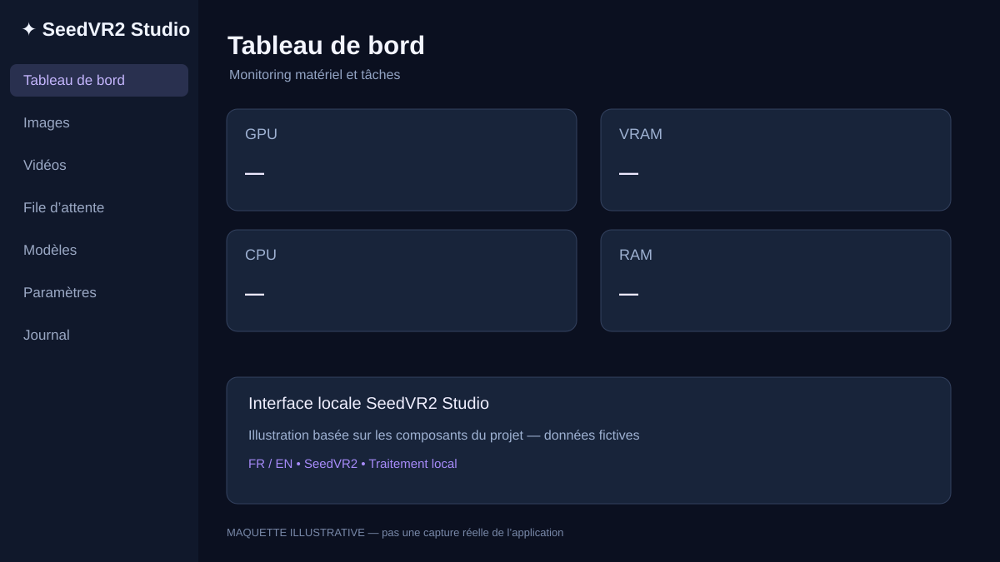
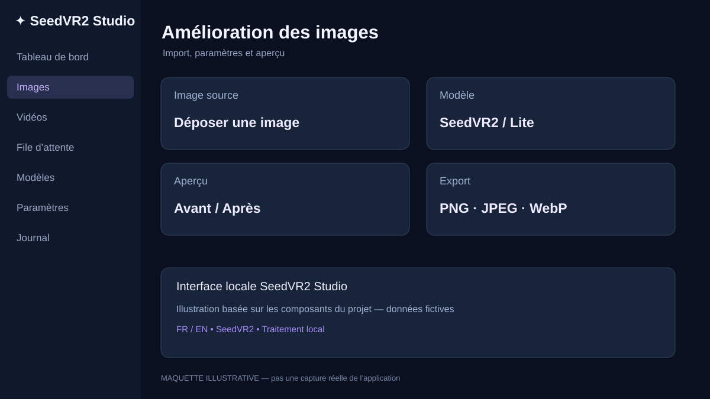
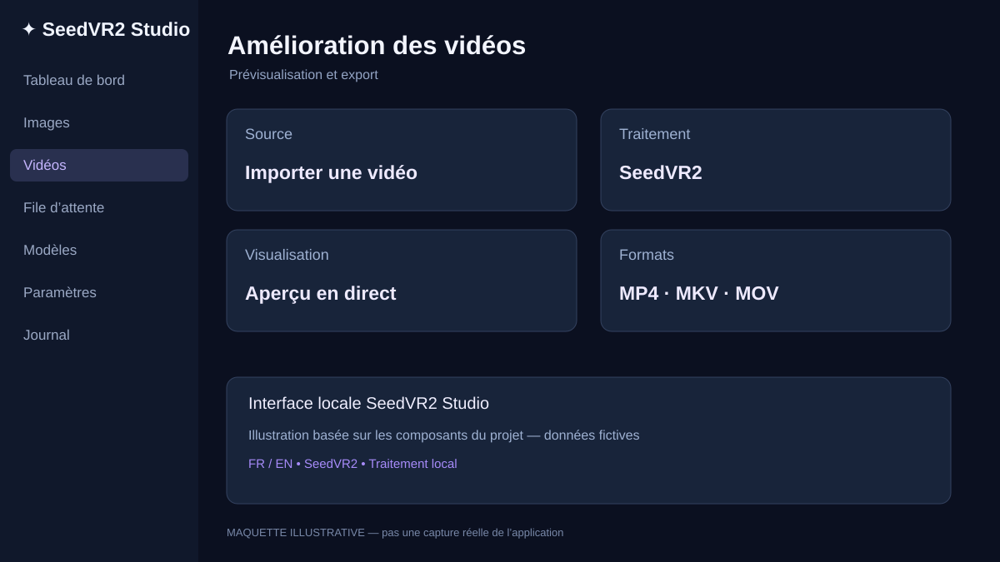

# SeedVR2 Studio

**Enhance your images and videos with SeedVR2 through a local web interface available in English and French.**



> **About the visuals:** The images in this README are **illustrative mockups based on the interface code**, not screenshots of the application running. You can replace them with real screenshots later.

## Features

- **Image and video upscaling** powered by SeedVR2 and **SeedVR2 Lite (GGUF)** variants.
- **Preview before export:** preview a full image, a video frame, or a sequence, with before/after comparison, zoom, and pan.
- **Live video export preview:** watch frames as they are generated.
- **Preview-to-export consistency:** reuse an approved preview result without generating it again.
- **Image formats:** PNG, JPEG, WebP, TIFF, BMP, AVIF, and EXR.
- **Video containers:** MP4, MKV, MOV, WebM, and AVI; H.264, H.265, AV1, VP9, ProRes, and FFV1 codecs (depending on available encoders).
- **Processing queue** with pause, cancellation, and GPU out-of-memory handling.
- **System dashboard:** GPU, VRAM, temperature, CPU, RAM, processing speed, and estimated time remaining.
- **Model manager:** resumable downloads, SHA-256 verification, deletion, and custom model directory selection.

## Interface

| Images | Videos |
|---|---|
|  |  |

Available sections: **Dashboard · Images · Videos · Queue · Models · Settings · Logs**.

## Quick Start

### Windows 10/11 (64-bit)

1. Download the project archive from **Releases** and extract it to a short path, such as `D:\SeedVR2_Studio`.
2. Run **`INSTALLER.bat`** and select the models you want to install.
3. Run **`LANCER.bat`** and open **http://127.0.0.1:7860** (a different port may be used if needed).

The installer sets up dependencies, PyTorch, FFmpeg, and the selected models. An internet connection is required for the initial downloads.

### Linux / macOS

```bash
chmod +x install.sh launch.sh update.sh uninstall.sh
./install.sh
./launch.sh
```

On macOS, install FFmpeg using `brew install ffmpeg`. Performance on Apple Silicon (MPS) may be slower.

## System Requirements

| Component | Project-stated minimum | Recommended |
|---|---|---|
| GPU | NVIDIA GPU with 6–8 GB VRAM using Lite GGUF + BlockSwap | NVIDIA GPU with 16–24 GB VRAM |
| NVIDIA driver | ≥ 520 | ≥ 570 (required for RTX 50-series according to project documentation) |
| RAM | 16 GB | 32 GB or more |
| Storage | 15 GB plus models (approximately 2.4–76 GB) | SSD |
| Operating system | Windows 10/11, Linux, macOS Apple Silicon | NVIDIA GPU for best performance |

**Python 3.10–3.13** is supported (3.12 recommended). Performance depends on the model, available VRAM, and hardware.

## Model Installation Presets

| Preset | Included models | Approximate download size |
|---|---|---|
| Recommended | VAE, SeedVR2 3B FP16 / FP8, 7B FP8, Lite 3B Q4 / Q8, and 7B Q4 | ~30 GB |
| Full | 11 files, including 7B FP16 and Sharp variants | ~76 GB |
| Minimal | VAE + Lite 3B Q4 | ~2.4 GB |
| None | Download models later from the Models tab | — |

## 🔧 Maintenance

| Action | Windows | Linux / macOS |
|---|---|---|
| Launch | `LANCER.bat` | `./launch.sh` |
| Update dependencies and models | `METTRE_A_JOUR.bat` | `./update.sh` |
| Uninstall | `DESINSTALLER.bat` | `./uninstall.sh` |

**Application log:** `data/logs/seedvr2_studio.log`.

## Documentation

- [Installation guide (French)](docs/GUIDE_INSTALLATION.md)
- [User guide (French)](docs/GUIDE_UTILISATION.md)
- [Architecture and tests](docs/ARCHITECTURE.md)
- [Models and licenses (French)](docs/MODELES_ET_LICENCES.md)

## Local Operation and Licensing

The web interface is hosted locally at `127.0.0.1:7860` by default. Initial downloads require network access. **SeedVR2 Studio** is licensed under **Apache-2.0** (see `LICENSE`). It integrates the third-party [ComfyUI-SeedVR2_VideoUpscaler](https://github.com/numz/ComfyUI-SeedVR2_VideoUpscaler) engine, also licensed under Apache-2.0, and is based on [SeedVR2 / ByteDance Seed](https://github.com/ByteDance-Seed/SeedVR). See the [model credits and licensing terms](docs/MODELES_ET_LICENCES.md).

---

*An independent project built around SeedVR2. Third-party project names belong to their respective owners.*
