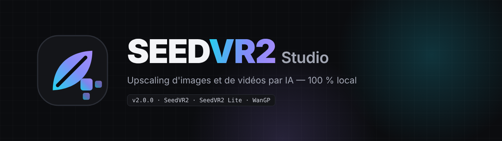
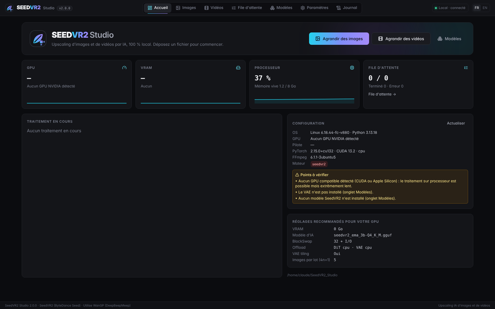
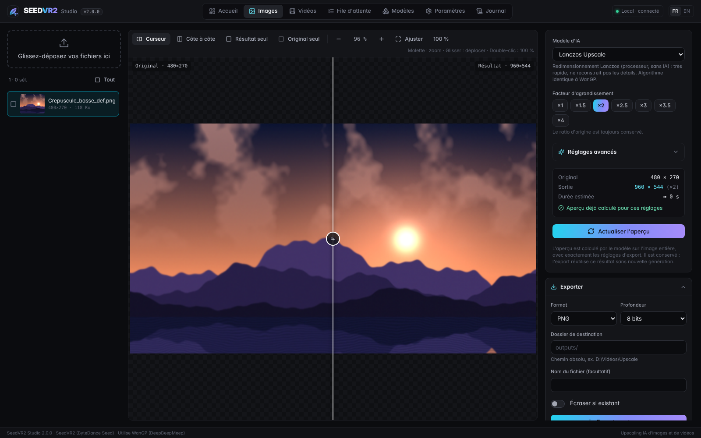
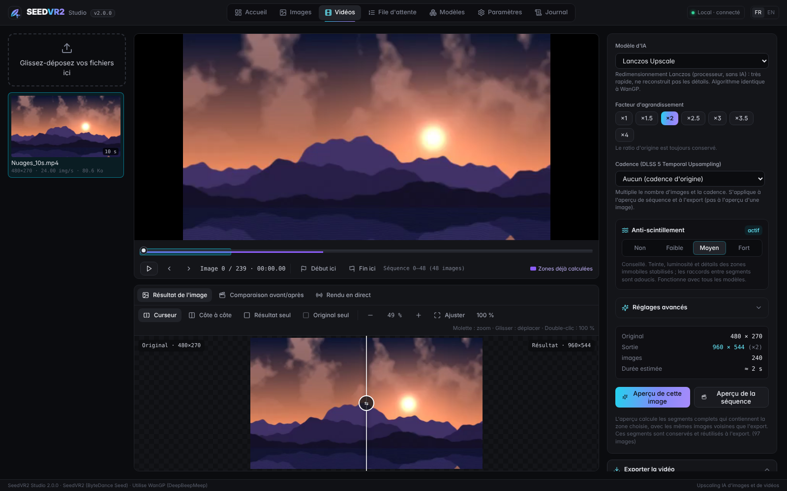
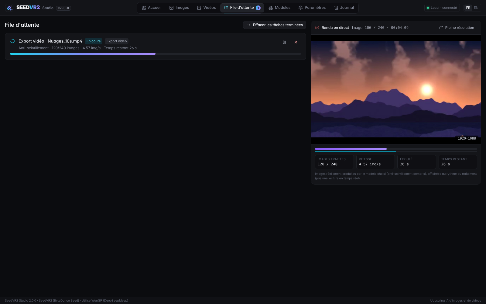
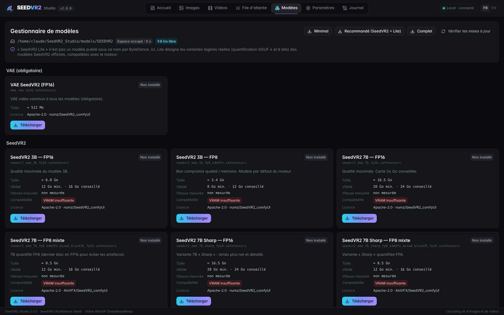
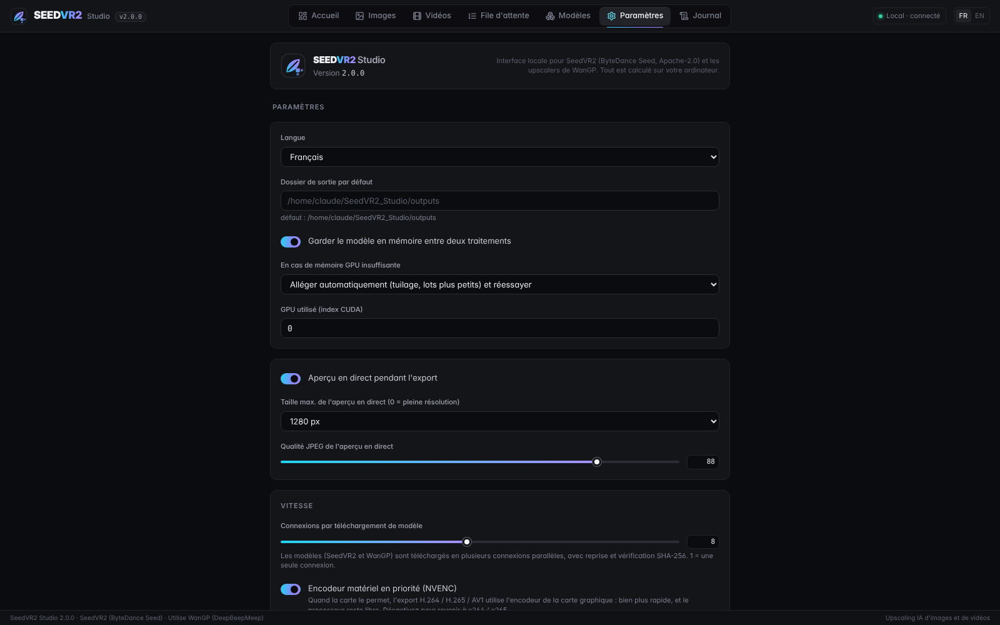

<p align="center">
  
</p>

<p align="center">
  <b>Version 2.0.0</b> · Windows · Linux · macOS (Apple Silicon, lent) · Interface en français et en anglais
</p>

**SeedVR2 Studio** est une interface locale pour agrandir et restaurer des **images** et des **vidéos** avec
**SeedVR2** (ByteDance Seed), ses variantes légères **SeedVR2 Lite** (GGUF), le modèle communautaire
**SeedVR2 1.4B**, et les upscalers **WanGP « System Video Postprocessing »** : LTX 2.5 Upscale, LTX 2.5 Detail
Refiner, LTX 2.3 Upscale, RelayVSR, Lanczos, FlashVSR One Pass / Two Pass, DLSS 5 Spatial et DLSS 5 Temporal
Upsampling. Tout est calculé sur votre ordinateur : aucune image ne quitte votre machine.

> **Utilise WanGP** (© DeepBeepMeep, WanGP Community License 2.0 — usage gratuit, revente interdite) :
> https://github.com/deepbeepmeep/Wan2GP. WanGP est installé dans son propre environnement et utilisé sans
> modification, via son API officielle. SeedVR2 Studio n'est ni affilié à WanGP ni approuvé par son auteur.

## Nouveautés de la version 2.0

- **Nouvelle interface** : barre d'onglets en haut, visionneuse au centre, réglages à droite en cartes
  repliables, nouveau logo SEEDVR2, numéro de version affiché dans le logiciel.
- **Anti-scintillement vidéo, pour tous les modèles** (SeedVR2, Lite, 1.4B, WanGP, Lanczos) : teinte et
  luminosité recalées sur la vidéo source, fourmillement des détails lissé dans les zones immobiles,
  raccords entre segments adoucis. Quatre niveaux : Non, Faible, Moyen (par défaut), Fort.
- **Téléchargement des modèles plus rapide** : plusieurs connexions parallèles (8 par défaut), empreinte
  SHA-256 calculée pendant le téléchargement, reprise conservée. Les poids des upscalers WanGP passent
  aussi par ce téléchargeur.
- **Encodage vidéo plus rapide** : FFmpeg encode pendant que le modèle calcule le segment suivant, les images
  sources sont décodées à l'avance, et l'encodeur matériel NVENC est choisi automatiquement quand il existe.

Le détail est dans [CHANGELOG.md](CHANGELOG.md).

## Aperçu

| Accueil | Images : comparaison avant / après |
|---|---|
|  |  |

| Vidéos : aperçu d'une image et anti-scintillement | Export : les images calculées défilent en direct |
|---|---|
|  |  |

| Gestionnaire de modèles | Paramètres |
|---|---|
|  |  |

<sub>Captures réalisées sans carte graphique, avec l'upscaler Lanczos (qui fonctionne sans GPU) et des
médias de démonstration générés pour l'occasion. Le rendu des modèles d'IA dépend du modèle et de votre carte.</sub>

## Fonctions

- **Installation automatique** : PyTorch adapté à votre carte, dépendances, FFmpeg, modèles SeedVR2 + Lite
  au choix, WanGP en option.
- **Aperçu réel avant export** : image entière, image d'une vidéo ou séquence vidéo, avec comparateur
  avant / après (curseur, côte à côte), zoom et déplacement.
- **Aperçu = export** : le résultat validé en aperçu est réutilisé tel quel à l'export, sans nouvelle génération.
- **Rendu en direct pendant l'export** : les images réellement produites défilent, avec le numéro d'image,
  la vitesse, le temps écoulé et le temps restant.
- **Formats** : PNG, JPEG, WebP, TIFF, BMP, AVIF, EXR · MP4, MKV, MOV, WebM, AVI · H.264, H.265, AV1, VP9,
  ProRes, FFV1 (sans perte). Les combinaisons incompatibles sont refusées.
- **File d'attente**, pause, annulation, et allègement automatique des réglages quand la mémoire du GPU manque.
- **Tableau de bord** : GPU, VRAM, température, processeur, mémoire, travaux en cours.
- **Gestionnaire de modèles** : téléchargement parallèle avec reprise, vérification SHA-256, mises à jour,
  suppression ; inventaire et téléchargement des poids WanGP upscaler par upscaler.

## Démarrage rapide (Windows)

1. Extrayez l'archive dans un dossier au chemin court, sans caractères spéciaux (ex. `D:\SeedVR2_Studio`).
2. Double-cliquez sur **`INSTALLER.bat`** et choisissez les modèles à télécharger.
3. Acceptez l'installation de **WanGP** (proposée par l'installateur) pour les upscalers LTX, FlashVSR,
   RelayVSR et DLSS 5.
4. Facultatif, pour DLSS 5 : **`INSTALLER_DLSS5.bat`** (Windows 11 + RTX, composants tiers à accepter).
5. Lancez **`LANCER.bat`** : le navigateur s'ouvre sur `http://127.0.0.1:7860`.

Linux / macOS : `./install.sh` puis `./launch.sh`.

**Mise à jour depuis la 1.x** : extrayez la nouvelle version par-dessus l'ancienne, puis lancez
`METTRE_A_JOUR.bat`. Vos modèles, réglages et WanGP sont conservés. Les aperçus vidéo déjà calculés sont
recalculés une fois, car l'anti-scintillement fait désormais partie du résultat.

## Configuration conseillée

| | Minimum | Conseillé |
|---|---|---|
| Carte graphique | NVIDIA 6–8 Go (modèles Lite GGUF ou 1.4B + BlockSwap) | NVIDIA 16–24 Go |
| Pilote NVIDIA | ≥ 520 | ≥ 570 (obligatoire pour les RTX 50) |
| Mémoire vive | 16 Go | 32 Go et plus |
| Disque | 15 Go + modèles (2,4 à ≈ 79 Go) | SSD |
| Système | Windows 10/11 64 bits, Linux, macOS Apple Silicon (lent) | |

## Documentation

- [Guide d'installation](docs/GUIDE_INSTALLATION.md)
- [Guide d'utilisation](docs/GUIDE_UTILISATION.md)
- [Architecture technique, fidélité et tests](docs/ARCHITECTURE.md)
- [Modèles, sources et licences](docs/MODELES_ET_LICENCES.md)
- [Historique des versions](CHANGELOG.md)

## Développement

```bash
# serveur (moteur factice pour les tests, sans GPU)
cd backend && python -m pytest -q
# interface
cd frontend && npm install && npm run build
```

L'interface compilée (`frontend/dist`) est incluse dans le dépôt : l'installateur ne demande pas Node.js.

## Crédits

SeedVR2 : ByteDance Seed (Apache-2.0) — moteur d'inférence : ComfyUI-SeedVR2_VideoUpscaler
(numz / AInVFX, Apache-2.0) — SeedVR2 1.4B : lvladikov (Apache-2.0, dérivé de SeedVR2-7B) — upscalers
complémentaires : WanGP (DeepBeepMeep, WanGP Community License 2.0). Détails dans
[docs/MODELES_ET_LICENCES.md](docs/MODELES_ET_LICENCES.md).

SeedVR2 Studio est distribué sous licence [Apache-2.0](LICENSE).
