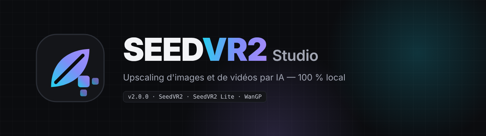

# SeedVR2 Studio 2.0.0

Upscaling local d'images et de vidéos avec SeedVR2, SeedVR2 Lite, SeedVR2 1.4B et les upscalers WanGP.

## Nouveautés

**Nouvelle interface.** Onglets en haut, visionneuse au centre, réglages à droite en cartes repliables,
nouveau logo SEEDVR2, version affichée dans le logiciel. Accueil simplifié avec un accès direct aux images,
aux vidéos et aux modèles.

**Anti-scintillement vidéo pour tous les modèles.** Nouveau réglage Non / Faible / **Moyen** / Fort dans la
page Vidéos. La teinte et la luminosité sont recalées sur la vidéo source, le fourmillement des détails est
lissé dans les zones immobiles (sans traînées sur ce qui bouge) et les raccords entre segments sont adoucis.
L'aperçu reste identique à l'export.

**Téléchargements plus rapides.** Les modèles sont téléchargés en 8 connexions parallèles (réglable), avec
vérification SHA-256 pendant le téléchargement et reprise conservée. Les poids des upscalers WanGP en
profitent aussi.

**Encodage vidéo plus rapide.** L'encodage se fait pendant le calcul du segment suivant, les images sources
sont décodées à l'avance, et NVENC est utilisé automatiquement quand la carte le permet.

## Installation

1. Téléchargez **`SeedVR2_Studio_v2.0.0.zip`** ci-dessous et extrayez-le dans un dossier au chemin court
   (ex. `D:\SeedVR2_Studio`).
2. Lancez **`INSTALLER.bat`**, puis **`LANCER.bat`**.

**Depuis la 1.x** : extrayez l'archive par-dessus l'ancienne version, puis lancez `METTRE_A_JOUR.bat`.
Modèles, réglages et WanGP sont conservés ; les aperçus vidéo déjà calculés sont recalculés une fois.

## À savoir

- Les gains de vitesse dépendent de votre machine : l'encodage en tâche de fond fait gagner surtout quand le
  calcul du modèle est long ; NVENC demande une carte NVIDIA qui le gère.
- L'anti-scintillement corrige la teinte, la luminosité et le fourmillement des zones immobiles ; il ne
  corrige pas une déformation de forme.
- Validé par 51 tests automatiques (sans GPU). Le rendu réel des modèles d'IA reste à juger sur votre carte.

Historique complet : [CHANGELOG.md](../CHANGELOG.md).
